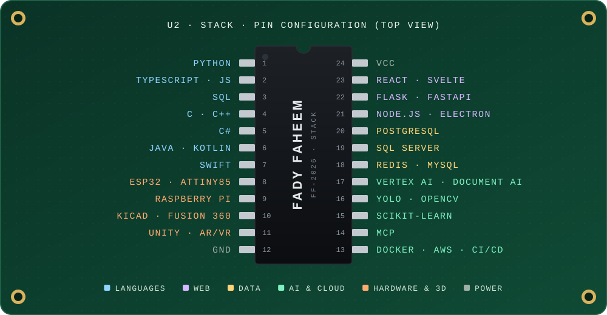

<p align="center">
  
</p>

<p align="center">
  <a href="https://github.com/FadyFaheem/FadyFaheem/blob/main/Fady_Faheem_Resume.pdf"><b>Resume</b></a>
  &nbsp;·&nbsp;
  <a href="https://www.linkedin.com/in/fady-faheem/"><b>LinkedIn</b></a>
  &nbsp;·&nbsp;
  <a href="https://www.fadyfaheem.com"><b>fadyfaheem.com</b></a>
  &nbsp;·&nbsp;
  <a href="mailto:fadyfaheem@hotmail.com"><b>fadyfaheem@hotmail.com</b></a>
  <br />
  <sub>Fort Worth, TX · open to relocation</sub>
</p>

I build software that has to work in the physical world: tools for Bell 525 helicopters, warehouse systems at FedEx, and an open-source ESP32 stream deck with thousands of downloads. Lately, that means applied AI on Google Cloud.

## ⚡ Right now

- **Labor Forecast AI** · I'm the lead architect and developer of a Vertex AI model that forecasts staffing across FedEx Office locations. It's in pilot UAT with workforce planners, who project about **$10M a year** in savings.
- **Lease Document AI** · a Document AI pipeline that pulls terms, dates, and obligations out of leases so nobody has to read them line by line.
- **[Stream32](https://github.com/FadyFaheem/Stream32)** · shipping new releases of my open-source ESP32 stream deck.

## 🔩 Featured builds

<table>
  <tr>
    <td width="50%" valign="top">
      <h3><a href="https://github.com/FadyFaheem/Stream32">Stream32</a></h3>
      <p>An open-source stream deck built from an off-the-shelf ESP32 touch display. The Electron app for Windows, macOS, and Linux flashes the firmware over USB and lays out pages of keys with plugin actions. Sponsored by PCBWay.</p>
      <p><b>100 ★ · 42 releases · 3,700+ downloads</b></p>
      <p><code>ESP32</code> <code>C</code> <code>Electron</code> <code>JavaScript</code></p>
    </td>
    <td width="50%" valign="top">
      <h3><a href="https://github.com/FadyFaheem/FuCad">FuCad</a></h3>
      <p>FreeCAD, reworked to feel like Fusion 360: a ribbon, a timeline that rolls features back, and merged extrude/cut tools. The kernel, Python API, and file format stay intact, so existing documents and macros still work.</p>
      <p><b>44 ★ · 22 releases</b></p>
      <p><code>C++</code> <code>Qt</code> <code>GitHub Actions</code></p>
    </td>
  </tr>
  <tr>
    <td width="50%" valign="top">
      <h3><a href="https://github.com/FadyFaheem/jda-mcp">jda-mcp</a></h3>
      <p>An MCP server that gives AI agents safe access to Blue Yonder (JDA) WMS: 27 tools, MOCA TCP and HTTPS clients, a read-only guard that catches writes hidden in CTEs or comments, and human-approved writes that never auto-retry.</p>
      <p><code>TypeScript</code> <code>MCP</code> <code>Node.js</code></p>
    </td>
    <td width="50%" valign="top">
      <h3><a href="https://github.com/FadyFaheem/Foreshock">Foreshock</a></h3>
      <p>Bearing-fault detection from vibration data, inspired by aircraft health monitoring. Envelope (Hilbert), FFT, and time-domain features feed a RandomForest, served by a Flask API with a React + TypeScript dashboard.</p>
      <p><code>Python</code> <code>scikit-learn</code> <code>Flask</code> <code>React</code></p>
    </td>
  </tr>
  <tr>
    <td width="50%" valign="top">
      <h3><a href="https://github.com/FadyFaheem/REKT-Mini">REKT-Mini</a></h3>
      <p>A rotary-engine compression tester on a custom PCB. ATtiny85 firmware auto-zeroes the pressure sensor, catches each rotor face's compression peak, and derives cranking RPM, for about $30 instead of $200+.</p>
      <p><code>C++</code> <code>ATtiny85</code> <code>KiCad</code></p>
    </td>
    <td width="50%" valign="top">
      <h3><a href="https://github.com/FadyFaheem/JustAVendingMachine">Raspberry Pi Vending Machine</a></h3>
      <p>A broken vending machine I brought back to life at 17 with a Raspberry Pi 4, Java, MariaDB, a bill acceptor, and Arduino-driven relays.</p>
      <p><b>Featured in <a href="https://www.raspberrypi.com/news/refurbished-vending-machine/">The MagPi #130</a>, Tom's Hardware, and PC Gamer</b></p>
      <p><code>Java</code> <code>MariaDB</code> <code>Raspberry Pi</code> <code>Arduino</code></p>
    </td>
  </tr>
</table>

**Also on the bench:** [Epilog-Camera](https://github.com/FadyFaheem/Epilog-Camera) (streams laser-cutter camera frames over a reverse-engineered protocol) · [Voxels](https://github.com/FadyFaheem/Voxels) (a modular clock) · [SuperSuite](https://github.com/FadyFaheem/SuperSuite) (a VS Code extension for NetSuite SuiteScript)

## 🧭 Career

```text
$ git log --graph --oneline career
* 2026  FedEx Office ......... Ops Emerging Technology Developer
│       Labor Forecast AI on Vertex AI (pilot UAT) · lease Document AI pipeline
* 2025  FedEx Supply Chain ... Automation Technician → Senior Business Analyst III
│       MWMS: schema per contract, setup 6 months → under an hour · YOLO: −88% errors
* 2022  Bell Textron ......... IT Software Intern → Media-IT Support Administrator
│       Bell 525 IVHM tool · led VIPER 2.0 (Unity) · 3D-printed parts, $48K+/yr saved
* 2021  Edkit Studios ........ Unity Game Developer Intern
        Math Hunt, an AR/VR math game (SkillsUSA Texas finalist)
```

## 🔌 Stack

<p align="center">
  
</p>

## 🏆 Also

- 🥇 **SkillsUSA Cybersecurity, National 1st Place** (2023)
- 🎓 **B.S. Software Engineering** and **M.B.A., IT Management**, Western Governors University
- ☁️ AWS Certified Cloud Practitioner
- 🖨️ Designed a 3D-printed rotor-hub transmission lock for the Bell 525 that costs under $20 and replaced a $4,000 part with a one-year lead time
- 🗣️ English and Arabic

<p align="center"></p>
